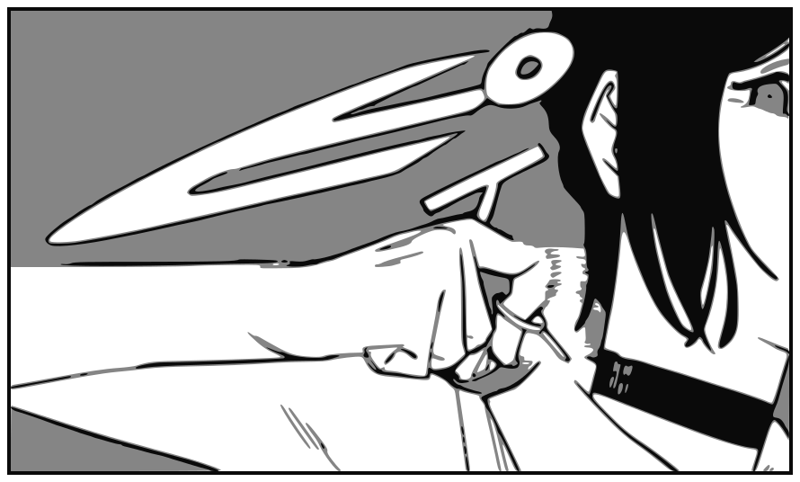

<div align="center">



# Reze

**A menu-bar app that turns short triggers into full prompts — and the images and video that go with them.**

</div>

---

Built for macOS, and for Linux under X11 — GNOME, KDE or any window manager on
Xorg. Every feature works on both: the palette, expanding in place (terminals
included), attachments, the clipboard history with its app badges, and starting
at login. Where Linux differs — mostly the hotkeys — it says so, and
[On Linux](#on-linux) collects it. **Wayland is not supported** — it blocks
synthetic input into other applications by design, which is the mechanism this
whole app rests on.

Hit a global hotkey anywhere, type `full analysis`, press Enter — the paragraph
you actually meant gets pasted into whatever app you were already in.

```
┌──────────────────────────────────────────────────────────────┐
│ 🔍  full an                                              3   │
├──────────────────────┬───────────────────────────────────────┤
│ ▸ full analysis      │ Deep end-to-end read of a codebase    │
│   #review #analysis  │ ───────────────────────────────────── │
│   security audit     │ Be rigorous and concrete. Cite every  │
│   #review #security  │ claim with a `file:line` reference…   │
└──────────────────────┴───────────────────────────────────────┘
  ↵ select   ⌘↵ copy only   esc close          Edit macros
```

## Install

```bash
make
```

One command is the whole path: it stops any running copy, builds the app with
bun, signs and notarizes it if it can ([Signing](#signing)), puts a fresh
**Reze.app** in `/Applications`, and launches it. After pulling changes,
`make update` runs the same refresh.

`make build` alone produces both bundles under
`src-tauri/target/release/bundle/` without touching `/Applications`:

| Path | What |
| --- | --- |
| `macos/Reze.app` | The app itself (~12 MB) |
| `dmg/Reze_<version>_aarch64.dmg` | Disk image (~4 MB) with a drag-to-`Applications` layout |

The disk image is laid out by scripting Finder, which macOS only lets a
terminal do once you have allowed it. Where that is not possible — over ssh,
say — `make` carries on without one and installs the app all the same.

There is no Dock icon and no window on launch — it is a menu-bar app, so look
for the bomb glyph up top. Press `⌘⇧Space` to confirm it is alive.

Two things to know on first run:

- **Grant Accessibility when macOS asks.** Until then the palette still works,
  and `⌘↵` still copies to the clipboard. How often it asks depends on how the
  build is signed — once ever, or once per build. See [Signing](#signing).
- **Without a certificate it is ad-hoc signed, not notarized.** Building and
  running it on your own machine is fine — locally built apps never get the
  quarantine flag. Copy that `.dmg` to another Mac and it *will* be flagged,
  and Gatekeeper will refuse to open it. There, either right-click the app →
  **Open**, or strip the flag:
  `xattr -dr com.apple.quarantine /Applications/Reze.app`.

`make build` targets the host architecture — `aarch64` on Apple Silicon. For a
binary that also runs on Intel Macs, build
`bun run tauri build --target universal-apple-darwin` (requires
`rustup target add x86_64-apple-darwin`).

To have it running from the moment you log in, turn on **Start Reze when I log
in** under Settings in the editor. That registers the app with macOS itself, so
it also appears under System Settings → General → Login Items — the two are the
same switch, and either one can turn it off. Needs macOS 13 or later, and the
installed `Reze.app` rather than a dev build.

Reinstalling an ad-hoc build replaces the app bundle and clears the
registration along with the Accessibility grant, so tick it again after
`make update`.

On Linux the same switch writes `~/.config/autostart/reze.desktop`, which every
freedesktop session starts at login and GNOME Tweaks lists under Startup
Applications. Reinstalling leaves it in place.

### Signing

macOS does not grant Accessibility to "Reze". It grants it to *whoever signed
Reze*, and checks that signature on every use. That is the whole story behind
permissions that go stale:

- **Signed with a Developer ID certificate**, every build has the same signer.
  Grant Accessibility once and it holds across `make update`, forever.
- **Ad-hoc** — what you get with no certificate — a build is signed by nobody,
  and its identity is the hash of that one binary. Every rebuild is a stranger.
  The old grant keeps looking ticked in System Settings while doing nothing,
  so `make` clears it and the new build asks again.

`make` signs with a *Developer ID Application* certificate if the keychain has
one, and falls back to ad-hoc if not. `make signing` says which it will be:

```
Signing:    Developer ID Application: Your Name (TEAMID1234)
Notarizing: with the 'reze-notary' keychain profile
Installed:  TEAMID1234
```

Setting that up is two things, once per Mac, and needs a paid Apple Developer
account:

1. **The certificate.** In Keychain Access: *Certificate Assistant → Request a
   Certificate From a Certificate Authority…*, saved to disk. Upload that file
   at [developer.apple.com → Certificates](https://developer.apple.com/account/resources/certificates/add),
   choosing **Developer ID Application**, then download the certificate it
   gives back and double-click it. (Only the account holder can create one.)
   With Xcode installed, *Settings → Accounts → Manage Certificates* does the
   same in one click.
2. **Somewhere for notarization to log in from.** Make an app-specific password
   at [account.apple.com](https://account.apple.com) → Sign-In and Security,
   then store it in the keychain under the name the Makefile looks for:
   ```bash
   xcrun notarytool store-credentials reze-notary \
     --apple-id you@example.com --team-id TEAMID1234
   ```
   It asks for the password and keeps it in the keychain; nothing is written
   to the repo.

Notarizing is the second half and is separate from the first. It is not what
keeps permissions — the signature does that — it is what lets the `.dmg` open
on a Mac that did not build it. With the certificate but no stored login,
`make` signs, skips notarizing, and says so. With both, it submits the disk
image, waits for Apple (a minute or two), and staples the answer to the image
and the app.

The first signed install clears whatever the ad-hoc builds left behind, so
Accessibility is asked for one last time. After that an install only clears it
if the signer changes. `make reset-permissions` does it by hand — every
permission macOS holds for Reze, and nothing belonging to any other app.

Dev builds (`bun run tauri dev`) are not signed, and are a separate entry in
System Settings that goes stale the same old way.

### On Linux

```bash
make
```

The same one command. It builds the binary, installs it as `~/.local/bin/reze`
with a desktop entry and icons under `~/.local/share` — so Reze is in the app
grid like anything else — and starts it. Nothing needs root, and after pulling
changes `make` (or `make update`) replaces the running copy.

What it needs:

- **An Xorg session.** On Ubuntu, pick *Ubuntu on Xorg* from the gear on the
  login screen.
- **bun, Rust, and Tauri's system libraries:**
  ```bash
  sudo apt install build-essential pkg-config libwebkit2gtk-4.1-dev libgtk-3-dev \
    libayatana-appindicator3-dev librsvg2-dev libxdo-dev
  ```
- **A tray host** for the icon. Ubuntu's session has one built in; stock GNOME
  needs the *AppIndicator and KStatusNotifierItem Support* extension. Without
  one the hotkeys still work, but there is no icon to open the editor from —
  the palette's **Edit macros** link does the same.
- **`gstreamer1.0-libav`**, to preview video. WebKitGTK plays video through
  GStreamer, and this is the H.264 decoder it can use. (On an NVIDIA Jetson the
  hardware decoder outranks it but hands frames back in GPU memory the web view
  cannot draw, so Reze ranks that one out for itself.)

There is no Accessibility permission to grant: X11 lets any app synthesize
input — and the reason Wayland is out is that it does not.

The hotkeys are different, because the macOS ones are taken on Linux:

| | macOS | Linux | Why not the same |
| --- | --- | --- | --- |
| Palette | `⌘⇧Space` | `Ctrl+Shift+Space` | — |
| Expand in place | `⌥Space` | `Ctrl+Alt+Space` | `Alt+Space` is the window menu in GNOME, KDE and most window managers, and a key another app has grabbed cannot be grabbed again |
| Clipboard history | `⌘⇧V` | `Super+Shift+V` | `Ctrl+Shift+V` is paste in every terminal, and a global hotkey would take it away from all of them |

Inside the palette and the editor, `⌘` is `Ctrl`. All three hotkeys can be
changed in Settings.

## Using it

There are two ways in. **Search** it when you want to browse, or **expand in
place** when you already know the trigger.

### Expand in place

Type a trigger straight into whatever you are already writing in, then press
`⌥Space`:

```
Please do a full analysis|          ← your caret, in any app
                    ⌥Space
Please do a Be rigorous and concrete. Cite every claim with…
```

Reze replaces the trigger with the expansion. No window appears, and the rest of
the line is left exactly as it was. If the words match nothing, nothing happens
and your text is untouched.

It works this out in one of two ways:

1. **What it saw you type.** Reze keeps the last 160 characters you typed and
   backspaces over the trigger. This is the only approach that works in a
   terminal or any TUI — `Option+←` there is an escape sequence to the shell,
   not a selection, and `⌘C` copies the terminal's view selection rather than
   the line you are editing. See [Typing awareness](#typing-awareness).
2. **Selecting and reading back the words at your caret.** Used when the first
   has nothing to offer — text typed before Reze started, or pasted rather than
   typed. Works in ordinary text fields, not in terminals.

Matching ignores case and prefers the longest trigger, so with both `analysis`
and `full analysis` defined, typing "full analysis" expands the longer one. If
the macro has variables, the palette opens on its fill-in step and the
replacement happens once you submit.

This needs a real key combination — a bare `Tab` cannot be used, because a
global shortcut swallows that key in *every* application.

### The palette

| Key | Does |
| --- | --- |
| `⌘⇧Space` | Open the palette over the current app (configurable) |
| `⌘⇧V` | Open it on the [clipboard history](#clipboard-history) instead |
| `tab` | Switch to the clipboard history — `tab` again comes back |
| `↑` `↓` / `⌃N` `⌃P` | Move through results |
| `↵` | Expand and paste — or open the fill-in step if the macro has variables |
| `⌘↵` | Put the expansion on the clipboard instead of pasting |
| `esc` | Back out of fill-in, or close |

Paste a **link** into the search field instead of a search and it turns into a
download. See [Pasting a link](#pasting-a-link).

The tray icon opens the macro editor, where you can add, edit, tag, duplicate
and delete macros, [attach files](#attachments) to them, rebind the hotkeys,
change how expansions are delivered, and set Reze to start at login.

### Quitting

Use **Quit Reze** in the tray menu, or `⌘Q` with the editor focused. A menu-bar
app has no application menu, so `⌘Q` has nothing to hang off by default — the
editor window handles it itself. `⌘W` there closes the window without quitting.

## Attachments

A macro can carry files as well as text — a screenshot, a reference video, a
PDF, anything. Trigger it and they arrive in whatever app you were in, the same
way the text does.

Three ways to attach one, in the editor:

- **Drop it** anywhere on the window.
- **`⌘V`** with a file or an image copied. Reze reads the real pasteboard rather
  than what the web view saw, so a file copied in Finder works as well as a
  screenshot taken with `⌘⇧4`.
- **Add file…** for the ordinary file picker.

Dropping onto an empty editor with nothing selected makes a new macro named
after the file, rather than refusing the drop.

### How they are delivered

A clipboard holds one payload, so a macro carrying both takes two passes:
**the text first, then the files.** That leaves the text landing exactly where a
text-only macro would put it — surrounding characters and all — and the
attachments follow. In a chat composer they drop into the attachment tray; in a
document they land after the paragraph.

`⌘↵` copies instead of pasting, and can only copy one thing: the text if there
is any, otherwise the files.

Images go on the clipboard as the file *and* as the picture, so an app that
inlines images gets one without reading the file, and an app that wants a file
gets a real one. Everything else goes as a file.

On Linux they go on the clipboard as a URI list — what browsers, Electron apps
and file managers read a pasted file from — and in Nautilus's own format, so
pasting into a folder copies them. An X11 clipboard holds one of each type
rather than one item per file, so only a macro with a single image also puts
the picture itself there — which a file manager given the choice takes, saving
it as "Pasted image" rather than under the file's own name.

### Where they live

Alongside the library, in `~/.reze/assets/`, under a generated name that
`macros.json` refers to:

```jsonc
"attachments": [
  {
    "id": "…",
    "file": "a1b2c3d4-….png",   // the name inside ~/.reze/assets
    "name": "Screenshot.png",   // what it was called when it came in
    "kind": "image",            // image | video | audio | file
    "mime": "image/png",
    "bytes": 261314
  }
]
```

Files are **copied in**, not linked, so a macro keeps working after the
screenshot it was made from is thrown away and the whole `~/.reze` directory
stays portable between machines.

Files no macro refers to any more are deleted after a save in the app — never
after an edit you make to `macros.json` yourself, because a text editor
mid-write can momentarily look like a library with no macros in it, and
sweeping on that would take every attachment with it. Anything imported in the
last minute is spared regardless, since a dropped file exists for a moment
before the macro that references it is written.

### Watched folders

Attaching files one at a time is fine for a handful. For a collection, point
Reze at the folder instead:

**Settings → Folders → Add folder…**

Every file in it becomes a macro on its own, named after the file, with its
subfolders as tags. Add a file and the macro appears; delete it and the macro
goes; rename it and the trigger changes. A folder like

```
~/refs/
├── memes/
│   └── cats/
│       └── tabby.png     →  trigger "tabby",  tags #memes #cats
└── logo.svg              →  trigger "logo"
```

is a library of two macros without a word typed into the editor.

These are **derived**, not authored, so:

- They are never written into `macros.json`. The folder is what they are made
  of, the way that file is for the ones you wrote.
- Their files are read where they lie — nothing is copied, because that folder
  is already yours and shadowing a hundred gigabytes of video inside `~/.reze`
  would be absurd.
- The editor shows them read-only. To make one yours — to add text around it,
  say — press **Make an editable copy**, which copies its file into the asset
  library and hands you an ordinary macro.
- Where a trigger name is claimed twice, the one you wrote wins.

Dotfiles are skipped, subfolders are followed eight deep, and the scan stops at
two thousand files so that pointing this at a home directory degrades rather
than hangs.

## Pasting a link

Open the palette and paste the URL of a post where you would type a search.
Reze recognises that it is a link rather than a query and offers to download it
instead:

```
┌──────────────────────────────────────────────────────────────┐
│ 🔍  https://www.youtube.com/watch?v=…                        │
├──────────────────────────────────────────────────────────────┤
│ Download from youtube.com                                    │
│ https://www.youtube.com/watch?v=…                            │
└──────────────────────────────────────────────────────────────┘
  ↵ download
```

`↵` downloads it into the first watched folder. When it lands, the palette asks
what to call it, with the name it worked out already filled in and selected —
so `↵` again accepts it, or type over it first:

```
┌──────────────────────────────────────────────────────────────┐
│ ↓  Downloaded                                                │
├──────────────────────────┬───────────────────────────────────┤
│ CALL IT                  │                                   │
│ ┌──────────────────────┐ │         ▶                         │
│ │ youtube - jawed - Me…│ │                                   │
│ └──────────────────────┘ │                                   │
└──────────────────────────┴───────────────────────────────────┘
  ↵ save   esc keep this name
```

The name you give it renames the file, and the file is what the macro is named
after — so it is a macro called exactly that, immediately.

Names are worked out from the post: the site, who posted it, and the title.
That is the point — a folder of `video.mp4` and `image.jpg` would be useless a
week later.

`esc` during a download leaves the naming step, not the download: it finishes
in the background and keeps the name it was given.

### What it uses

Nothing is bundled. Three tools are looked for, and **Settings → Downloading a
link** says which are present and what to type for the rest:

| Tool | For | Without it |
| --- | --- | --- |
| `yt-dlp` | Video, and the site knowledge for most of the web | No video from any post |
| `gallery-dl` | Images, which `yt-dlp` deliberately does not do | Image-only posts fail |
| `ffmpeg` | Joining the separate streams YouTube serves | Video capped around 720p |

```bash
brew install yt-dlp gallery-dl ffmpeg
```

They are searched for on `PATH` and in the usual Homebrew and MacPorts
locations, because an app launched from Finder inherits a `PATH` from `launchd`
that has none of them in it.

On Linux, take `ffmpeg` from the distribution and the other two from pipx, which
puts them in `~/.local/bin` where Reze looks:

```bash
sudo apt install ffmpeg pipx gstreamer1.0-libav
pipx install yt-dlp && pipx install gallery-dl
```

Not the distribution's `yt-dlp`: it is released months behind the sites it has
to keep up with, and a yt-dlp that old no longer downloads from YouTube at all.
`gstreamer1.0-libav` is not for downloading — it is the H.264 decoder the
palette's video preview plays through.

A link straight to a file — `…/photo.png` — skips all three and is fetched with
`curl`, so that much works with nothing installed.

Video is asked for as **H.264 in mp4** where the site offers it. Asking for the
container alone is not enough: AV1 is also mp4, and macOS plays almost none of
it — not in Messages, not in Keynote, not in this app's own preview.

### What it will not do

Only public posts. Nothing here logs in, supplies credentials, or works around
access control — anything you could not open in a browser cannot be grabbed
either. It is a faster way to save what you can already see, and respecting
whatever the site's terms allow you to save is on you.

## Clipboard history

Press `⌘⇧V` anywhere and the same palette opens on everything you have copied,
newest first — **with the app you copied it from**.

```
┌──────────────────────────────────────────────────────────────┐
│ 📋  Search clipboard…                                        │
├───────────────────────────────┬──────────────────────────────┤
│ ▸ ▤ˢ update the version, com… │ Safari              4:31 PM  │
│     Text · Safari · Copied 4… │ ──────────────────────────── │
│   ▤ᵗ SELECT * FROM macros WH… │ update the version, commit,  │
│     Text · Terminal · Copied… │ push, open a pr, and merge…  │
│   ▨ᶜ                          │                              │
│     PNG image · Chrome · Cop… │                              │
└───────────────────────────────┴──────────────────────────────┘
  ↵ paste   ⌘↵ copy only   ⌘⌫ forget   esc close   tab Macros
```

| Key | Does |
| --- | --- |
| `↑` `↓` / `⌃N` `⌃P` | Move through the list |
| `↵` | Paste it back into the app you were in |
| `⌘↵` | Put it on the clipboard without pasting |
| `⌘⌫` | Forget this one |
| `tab` | Back to the macros |
| `esc` | Close |

Typing filters. Unlike the macro search this is a plain substring match, not a
fuzzy one — a clipboard entry is up to eight hundred characters of arbitrary
text, and a fuzzy match against that would find everything.

**Text, images and files all come back as what they were.** An image copied out
of a browser goes back onto the pasteboard as an image, not as a file attachment
named after a UUID. Files copied in Finder are remembered where they lie and
pasted as files. Text is pasted as text, including the part too long to show in
the preview.

### Where the app icon comes from

Nothing on the pasteboard says who wrote it — macOS records no owner. So Reze
takes whoever was frontmost at the moment the pasteboard changed, which is the
same inference every clipboard manager on the platform makes. It is right unless
you copy and switch apps inside the same half second. The icon is asked of the
running app once and cached in `~/.reze/clipboard/icons/`, so a hundred entries
from Safari cost one icon.

X11 is no different in what it records — the clipboard has an owner, but that
is whichever window last claimed it, not an app — so on Linux it is the focused
window when the clipboard changed. Its name comes from the app's desktop entry
("Google Chrome", not `google-chrome`) and its icon from the window itself.

### What it does not record

- **Anything an app marks private.** Password managers and their kind put
  `org.nspasteboard.ConcealedType` (or `TransientType`, or `AutoGeneratedType`)
  on the pasteboard alongside the value. Reze honours all of them and skips the
  copy entirely. On Linux the equivalent is `x-kde-passwordManagerHint`, which
  KeePassXC and its kind set.
- **Its own traffic.** Reze writes to the pasteboard constantly — every paste,
  every clipboard restore, and the synthesized `⌘C` that
  [expand in place](#expand-in-place) uses to read the words at your caret.
  Recording would fill the history with the app.
- **Anything copied before it started.** There is no backlog to read.
- **Text over 1 MB, or images over 32 MB.** The index is rewritten on every
  copy, and one pasted log file would make every copy after it pay for that.

### Where it lives

`~/.reze/clipboard.json`, with copied images in `~/.reze/clipboard/`. **In plain
text, on this machine, and nowhere else** — nothing is sent anywhere. It is
deliberately not part of `macros.json`: that file is watched for external edits
and rebroadcast to both windows, and a history rewriting it on every copy would
have them repainting all day.

Settings → **Clipboard history** rebinds the hotkey, sets how many items to keep
(200 by default), switches recording off, and clears the lot.

## Template syntax

Deliberately tiny — anything more expressive belongs in the prompt itself.

| Syntax | Meaning |
| --- | --- |
| `{{target}}` | A variable. The palette prompts you for it before pasting. |
| `{{target\|this codebase}}` | Same, pre-filled with a default. |
| `{{> rigor}}` | Inline another macro by its trigger, so shared preamble lives in one place. |
| `{{clipboard}}` | Whatever you last copied. |
| `{{date}}` `{{time}}` `{{datetime}}` | Filled automatically, never prompted. |

Includes nest, and a macro that (transitively) includes itself is reported in
the editor rather than recursing forever.

## Storage

Everything lives in `~/.reze/macros.json`, and **that file is the source of
truth** — the GUI is a convenience layer over it. Edit it in any text editor and
Reze picks up the change immediately; edit it in the app and your editor sees
the change on next read. Diff it, commit it, sync it however you like.

```jsonc
{
  "version": 1,
  "settings": {
    "hotkey": "CmdOrCtrl+Shift+Space",
    "expandHotkey": "Alt+Space", // expand the trigger at the caret
    "folders": ["~/.reze/media"],// every file in these becomes a macro
    "trackTyping": true,         // needed for expansion inside terminals
    "pasteMode": "paste",        // or "copy" to never paste directly
    "restoreClipboard": true,
    "clipboardHotkey": "CmdOrCtrl+Shift+V",
    "clipboardHistory": true,    // remember what you copy
    "clipboardLimit": 200,
    "shareOverTailscale": true   // let your other machines import this
  },
  "macros": [
    {
      "id": "…",
      "name": "full analysis",
      "description": "Deep end-to-end read of a codebase",
      "tags": ["review"],
      "body": "{{> rigor}}\n\nFully and thoroughly analyze {{target|this codebase}}…",
      "attachments": [], // see Attachments
      "usageCount": 0
    }
  ]
}
```

The [clipboard history](#clipboard-history) is deliberately *not* in here — it
has its own file, `~/.reze/clipboard.json`, because this one is watched for
external edits and a history rewriting it on every copy would never stop.

Two settings are deliberately not in here: the Accessibility grant and the
launch-at-login switch. Both are owned by macOS, and a copy of the answer in
this file would start lying the moment you changed it in System Settings — so
Reze reads them back from the OS instead of remembering them.

## Other devices

With [Tailscale](https://tailscale.com) running, Reze can copy the library from
another of your machines. **Settings → Other devices** lists them, says which
have a Reze answering, and imports from any that do:

```
● Tailscale is connected. This machine is mac-mini            Look again
┌──────────────────────────────────────────────────────────────────────┐
│ ● tenet   Linux                 16 macros · 5 attachments   Import… │
│ ○ midna   Linux                             Reze is not answering   │
│ ○ laptop  macOS                                           offline   │
└──────────────────────────────────────────────────────────────────────┘
```

**Import…** fetches that machine's library and says what would happen before
anything does:

```
 6  new                                     bug report, standup and 4 more
 2  different here — tenet's version wins   full analysis, rigor
 8  already the same
 2  only on this machine                    from clipboard, scratch

 (•) Add and update          keeps the 2 only this machine has
 ( ) Replace this library    removes them, leaving a copy of tenet's
 [ ] Bring its settings too
```

A macro there and a macro here are the same macro if they share an id or,
failing that, a trigger — every install seeds the same starter macros under ids
of its own, and two machines' `full analysis` should meet as one. Where both
have it and they differ, the other machine's version wins; the use count stays
yours. Attachments come along with the macros that carry them.

What never comes along: watched folders and the macros made from them, which
are paths on that machine; the clipboard history; and, between a Mac and a
Linux machine, the hotkeys, which are different on purpose.

The library as it was is set aside in `~/.reze/backups/` first — the last five
are kept, along with the attachments they name — and **Undo**, which appears
the moment an import finishes, puts the newest one back.

### What is listening

To be imported *from*, a Reze answers on port 7393 of its machine's Tailscale
address. Tailscale already encrypts the connection and knows who is on the
other end of it, so Reze adds no accounts, keys or pairing of its own — and
keeps what it does to three rules:

- **Only that address.** Not the local network, not the internet: nothing off
  your tailnet can open a connection at all.
- **Only your devices.** Each connection is put to `tailscale whois`, and
  anything not signed in as the same user as this machine — a colleague on a
  shared tailnet, a node shared in from another one, a tagged server — is
  refused whatever it asks for.
- **Only reading.** It hands over `macros.json` and the attachment files that
  names. No request changes anything; importing is something the other machine
  does to itself.

**Let my other devices import from this one** switches it off, and then nothing
listens. It is on by default so that a second machine finds the first without
a trip back to it.

Both machines need Tailscale signed in as the same user and a Reze new enough
to have this. If a machine shows as *not answering* and Reze is running there,
a firewall is the usual reason — with `ufw`, `sudo ufw allow in on tailscale0`.
It is plain HTTP inside the tunnel, so `curl http://tenet:7393/reze` shows what
another Reze would see.

## Typing awareness

Expanding in a terminal requires knowing what you typed, and nothing can be
read back out of a terminal's line editor. So Reze watches typing instead:

- It keeps the **last 160 characters**, in memory only. Never written to disk,
  never sent anywhere.
- It is discarded on Enter, Tab, Escape, any arrow or navigation key, any mouse
  click, any keypress with a modifier held, and whenever you switch apps.
- macOS disables event taps entirely while **secure input** is active, so
  password fields are never observed — not by policy, but by the OS.
- Turn it off with `trackTyping` in Settings. Expansion then falls back to
  selecting the words at your caret, which works in normal text fields but not
  in a terminal.

On Linux the same buffer is fed from XInput2's raw key events, with the same
limits and the same resets. Two things differ, and both are X11's doing:

- **Password fields are not exempt.** X11 has no secure input; any app may
  watch the keyboard. A password typed into a field passes through the buffer
  like anything else — held in memory only, never written anywhere, and gone at
  the Enter that submits it. If that is not acceptable, turn `trackTyping` off.
- **Only the first keyboard layout is read.** Someone switching layouts gets the
  selection fallback instead.

And in a Linux terminal the selection fallback is never tried: it copies with
`Ctrl+C`, which a terminal takes as SIGINT to whatever is running. There, only
what Reze saw typed can be expanded — and the expansion is pasted with
`Ctrl+Shift+V`, since a terminal takes plain `Ctrl+V` as a literal ^V. Terminals
are recognised by their window class (GNOME Terminal, Console, Ptyxis, Konsole,
kitty, Alacritty, WezTerm, Ghostty, foot, Tilix, xterm and the like). xterm
itself has no keyboard paste from the clipboard unless you give it one, so
expansions cannot land there.

The tap needs Accessibility permission to exist at all, so granting it *after*
launch leaves it uninstalled. Reze retries on the next expansion rather than
making you restart — that one attempt still falls back to selection.

## Accessibility permission

macOS has no supported way to inject text into another app, so pasting works by
putting the expansion on the clipboard and synthesizing `⌘V`. Expanding in place
additionally selects and copies the words before your caret to find out what you
typed. Both need **Accessibility** permission, and without it the keystrokes are
silently swallowed — the palette opens, and nothing arrives.

The editor shows a banner with a button that jumps straight to
System Settings → Privacy & Security → Accessibility when the permission is
missing. Your previous clipboard contents are restored a moment after the paste
lands (turn that off in Settings if you'd rather they weren't).

Note that the permission is granted to a signature: the dev build and a bundled
`Reze.app` are separate entries, and whether a rebuilt app counts as the one
you already allowed is down to how it was signed — see [Signing](#signing).

Linux has no such permission — X11 lets any app synthesize input — so there is
nothing to grant and no banner.

## Development

```bash
bun install
bun run tauri dev      # run it
bun run tauri build    # produce Reze.app + a .dmg in src-tauri/target/release/bundle
```

- `assets/icon.svg`, `assets/tray.svg` — icon sources (see below)
- `src-tauri/src/store.rs` — the JSON library, its schema, and the seed macros
- `src-tauri/src/paste.rs` — clipboard + synthesized keystrokes, and the permission check
- `src-tauri/src/assets.rs` — the attachment library on disk (`cargo test`)
- `src-tauri/src/clip.rs` — the pasteboard, for everything that is not text (and, on Linux, for text too)
- `src-tauri/src/folders.rs` — watched folders becoming macros (`cargo test`)
- `src-tauri/src/grab.rs` — a URL becoming a file (`cargo test`)
- `src-tauri/src/expand.rs` — which trigger the typed words name (`cargo test`)
- `src-tauri/src/typed.rs` — the keystroke tap behind terminal support (XInput2 on Linux)
- `src-tauri/src/focus.rs` — remembering who had focus, and pasteboard change detection
- `src-tauri/src/login.rs` — the launch-at-login switch, via `SMAppService` (an XDG autostart entry on Linux)
- `src-tauri/src/x11.rs` — Linux: focus, app names and icons, terminals (`cargo test`)
- `src-tauri/src/tailnet.rs` — other machines over Tailscale: finding them, answering them, asking them (`cargo test`)
- `src-tauri/src/merge.rs` — what importing another library does to this one (`cargo test`)
- `src-tauri/src/lib.rs` — windows, tray, global hotkeys, file watcher, IPC commands
- `src/lib/template.ts` — the template language (variables, includes, built-ins)
- `src/lib/fuzzy.ts` — the palette's ranking
- `src/Attachments.tsx` — attachment previews, shared by both windows
- `src/Palette.tsx`, `src/Editor.tsx` — the two windows, routed by window label

Both windows load the same bundle; `main.tsx` picks a component from
`getCurrentWindow().label`.

## Icons

Original artwork, hand-written SVG, in `assets/`. Both are a bomb-head wearing a
pulled grenade pin — a nod to the Bomb Devil's pin-in-the-neck that doubles as
the app's premise: pull a tiny pin, get an explosion.

| Source | Becomes | Notes |
| --- | --- | --- |
| `assets/icon.svg` | `src-tauri/icons/*` incl. `icon.icns`, `icon.ico` | Authored at 1024² with the macOS icon grid baked in (824² body, 100px margin), so generation only ever downscales. |
| `assets/tray.svg` | `src-tauri/icons/tray.png` | The menu-bar glyph. |

Regenerate both after editing either SVG (needs `rsvg-convert` — `brew install librsvg`):

```bash
bun run icons
```

The tray glyph is a macOS **template image**: pure black plus alpha, nothing
else. The system ignores the colour and tints the alpha itself, so it comes out
white on a dark menu bar and black on a light one automatically — drawing it
white would break that. `tray-icon` normalises menu-bar images to 18pt tall
preserving aspect ratio, so the glyph is authored square at 72px (4× for
Retina) with deliberately fat strokes that survive the downscale. It is
embedded with `include_bytes!` rather than bundled as a resource, so it cannot
go missing at runtime.

## Building

Always build with `bun run tauri build` (what `make build` runs) and install
the whole `.app`.

Running `cargo build` and copying just the binary over an installed bundle
looks like it works and does not: the frontend is embedded at compile time, and
a partially-rebuilt binary can end up with an `index.html` that references an
asset hash the embedded map no longer has. The window then loads, `#root` stays
empty, and no error surfaces anywhere — the app simply does nothing. If you ever
see that, `cargo clean -p reze` and build again properly.

## License

MIT — see [LICENSE](LICENSE).
